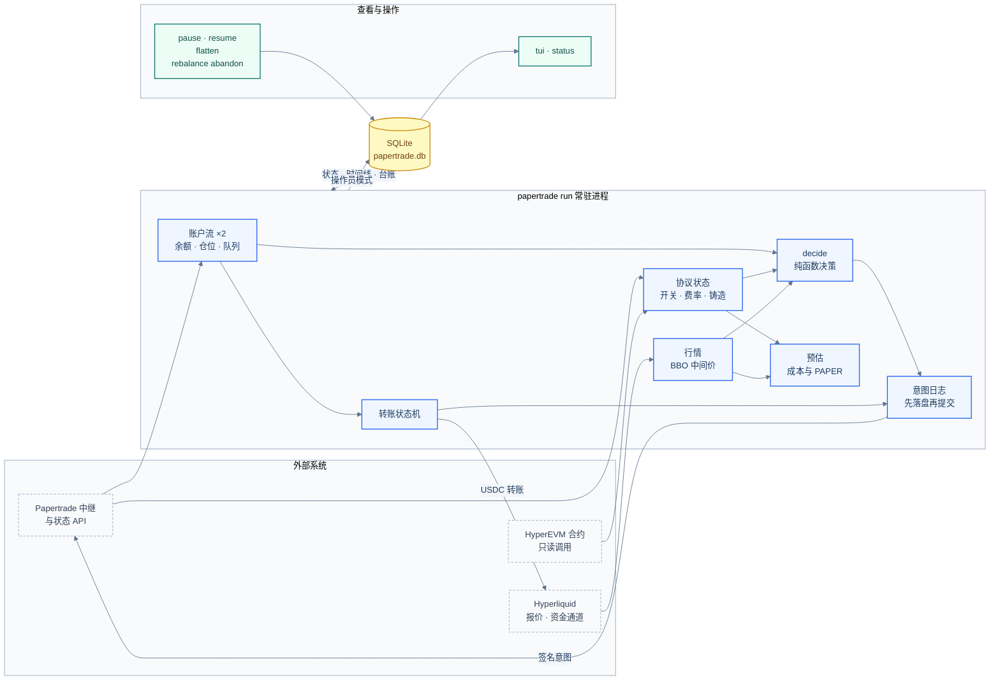
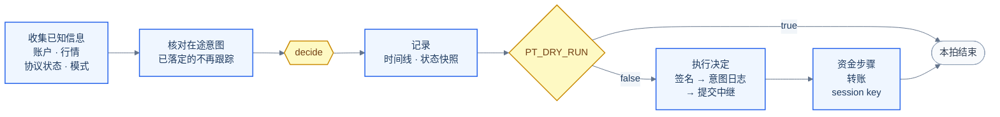
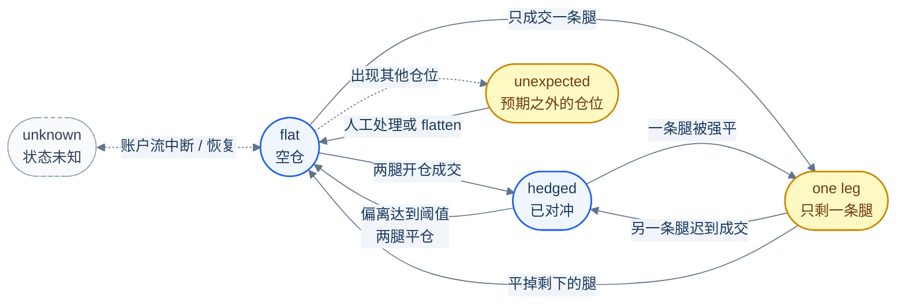
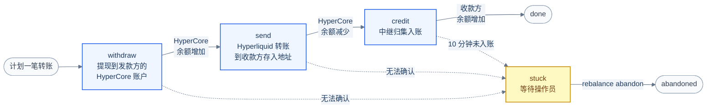

<div align="center">

# papertrade-rust

**Papertrade 双账户对冲机器人**

两个专用账户在同一市场一多一空、等额开仓，偏离达到阈值时一起平仓，循环往复

[工作原理](#how-it-works) · [从零到运行](#quickstart) · [日常运维](#operations) · [再平衡](#rebalance) · [参考](#reference) · [开发](#development)

</div>

---

papertrade-rust 是 [Papertrade](https://docs.papertrade.xyz/)（HyperEVM 上的合成永续协议）的双账户对冲机器人，一个 Rust 二进制。两个专用账户在同一市场一多一空、等额开仓；价格偏离开仓价达到阈值（默认 100 bps）时两边一起平仓，然后重复。亏损的一边按亏损额铸造 PAPER，两边合计的净损耗就是获得 PAPER 的成本。

围绕这一条策略，它提供一个完整的闭环：

- **决策与执行**：常驻进程 `papertrade run` 每 250 ms 用一个纯函数判断该等待、开仓还是平仓，签名后经中继提交。
- **本地账本**：SQLite 里有意图预写日志、时间线和成交台账。重启后从账户状态和日志接管，不重复开仓。
- **可见**：终端面板 `tui` 和纯文本 `status` 显示它看到什么、打算做什么、做过什么，以及每一轮的成本与 PAPER 预估。
- **可干预**：`pause` / `resume` / `flatten` 随时改变它的行为，不需要停进程。
- **密钥加密存放**：session key 和可选的主钱包私钥以密文落盘，启动时在终端输入一次密码解锁。
- **可选的资金自动化**：主钱包私钥在场时自动注册和续期 session key；再单独打开再平衡，才会在两个账户之间自动转移资金。两者默认关闭。

> [!WARNING]
> **它会用真实资金下单，风险自负。** 默认 `PT_DRY_RUN=true`：只决策和记录，不签名、不提交。
>
> - 协议没有公开 API。线路协议来自官方前端（`exchange.papertrade.xyz`）的实际行为，随时可能变化。
> - 合约是可升级代理。
> - 截至 2026-10-10，协议尚未开放交易（中继暂停 `openPosition` 与 `closePositions`）。开仓和平仓的签名已对线上合约做过只读模拟，但从未端到端执行过。
> - 仓位只能经中继平掉。中继暂停平仓期间，已有仓位无法关闭。
> - 同一组账户只运行一个机器人实例：两个实例互不知情，会各开一轮。

<a id="how-it-works"></a>

## 工作原理

### 一轮交易

默认配置（BTC、每腿仓位价值 10,000 USD、20 倍杠杆、阈值 100 bps）下的一轮：

| 步骤 | 发生什么 |
| :--- | :--- |
| 开仓 | 两个账户各出 500 USD 保证金，同时提交一多一空两个开仓意图 |
| 持有 | Hyperliquid 盘口中间价距两腿开仓均价不足 100 bps 时等待。20 倍杠杆的强平线约在 495 bps 处 |
| 平仓 | 达到阈值，先平亏损腿，再平盈利腿 |
| 结果 | 预估亏方 −100.00、赢方 +86.38、净额 −13.61 USD，铸造约 9,800 PAPER，每枚约 0.00139 USD |

结果一行是按协议规则算出的[预估](#estimate)，取决于链上费率（目前赢利费、亏损费、强平费都是 2%）和协议的铸造率（目前每 1 USD 铸造基数 100 PAPER）。面板上的金额是截断而不是四舍五入。

两条腿是两个独立的意图，不是原子的：可能落在不同区块，也可能只成功一条。这类情况的处理见[异常场景](#anomalies)。

### 架构



- **只有一个写入方。** 签名和提交只发生在常驻进程里。面板和操作命令都通过数据库和它交互，随时可开可关，不影响交易。
- **数据库就是机器人相信的事实。** 它看到什么、打算做什么、做过什么、结果如何，都能直接查。
- **意图先落盘再发送。** 重启后接着跟踪上次没有落定的意图，不会因为“不知道发没发出去”而重复开仓。
- **Hyperliquid 只是报价来源和资金通道。** Papertrade 按同一个盘口的中间价成交，所以行情取自那里；两户之间的转账要经过 HyperCore。机器人从不在 Hyperliquid 上交易或对冲。
- **链上只读。** HyperEVM 合约只用来读费率和存入地址。机器人不直接向链上发交易：开仓、平仓、提现、注册都是签名后的意图，交给中继；再平衡中间那笔 USDC 转账发给 Hyperliquid。

### 运行循环

`run` 每 250 ms 走一拍：



`decide` 自己不记任何东西：每一拍都从账户的实际状态重新推出答案，所以重启、强平或人工平仓之后都会直接走到正确的下一步。在途意图和开仓冷却来自意图日志，重启后同样还在。输入各有自己的节奏和新鲜度要求：

| 输入 | 来源 | 节奏与新鲜度 |
| :--- | :--- | :--- |
| 两个账户的余额、仓位、排队中的意图、session key | 状态 API 的账户流（SSE，每户一条） | 有变化即推送；每 30 秒重连取一次全量快照；断开或静默时该账户记为未知，失败后 1–30 秒退避重连 |
| 中间价 | Hyperliquid BBO（WebSocket） | 实时；超过 30 秒没更新视为没有报价 |
| 交易开关、品种参数、派彩队列 | `/state/trading`、`/query/protocol/queue-summary` | 每 5 秒 |
| 铸造曲线、三项费率 | `/query/protocol/summary`、链上 Exchange 合约 | 每 30 秒；只用于预估，读不到不影响开平仓 |
| 操作员模式 | 数据库 `control` 表 | 每拍 |
| 成交历史 | `/query/accounts/<钱包>/trades` | 每 60 秒，以及仓位数量变化时；写入台账 |

状态快照约每秒写一次数据库，由循环之外的任务完成：磁盘慢只会让面板滞后，不会拖慢决策。

### 两条腿的状态机

两条腿的状态每一拍都只由两个账户的实际仓位推出，面板和 `status` 里的 `legs` 就是它。



图里只画了从 `flat` 出发的虚线：账户流在任何状态下中断都会变成 `unknown`，恢复后直接落到实际仓位对应的状态；预期之外的仓位也可能在任何状态下出现。

| `legs` | 含义 | 机器人的动作 |
| :--- | :--- | :--- |
| `unknown` | 至少一个账户的状态不可用 | 等待 |
| `flat` | 两户都没有仓位 | [开仓条件](#decision)全部满足时两腿同时开仓；`pause` 和 `flatten` 模式下不开 |
| `hedged` | 两户各有一个方向正确的仓位 | 中间价距两腿开仓均价达到阈值时平仓，亏损腿先平 |
| `one leg (long)` / `one leg (short)` | 只有一户有仓位 | 立刻平掉它，不看价格 |
| `unexpected positions` | 出现策略不管理的仓位：同一户多于一个、别的市场或方向不对 | 不动，等人工处理或 `flatten` |

两条规则优先于上表：有开平仓意图在中继排队或刚发出不到 10 秒时，任何状态下都先等待；`flatten` 模式下平掉两户的所有仓位（包括预期之外的），不开仓。

<a id="quickstart"></a>

## 从零到运行

按顺序做完下面七步，就有一个在 dry run 下运行、可以随时切到实盘的机器人。所有命令都在仓库根目录执行：`.env`、`./secrets`、`./data` 都相对当前目录。

### 准备

| 需要 | 说明 |
| :--- | :--- |
| Linux | CI 在 Ubuntu 上运行。代码使用 Unix 信号和文件权限，不支持原生 Windows；其他 Unix 系统未测试 |
| [rustup](https://rustup.rs) 与 C 编译工具链 | `rust-toolchain.toml` 让 rustup 自动装上固定的 Rust 1.98.1；内置的 SQLite 和 TLS 加密库需要 C 编译器 |
| 两个专用钱包 | 一个只做多，一个只做空，不要用它们做别的交易。各自已在 Papertrade 入金：默认配置下每户至少要有一份保证金（500 USD）才会开仓，亏的一边每轮再少约 100 USD。本工具没有入金命令 |
| 能用主钱包做 EIP-712 签名的工具 | 手工注册 session key 时用，例如 Foundry 的 `cast`。使用主钱包自动化时不需要 |
| 网络与终端 | 要能访问 `exchange.papertrade.xyz`、`rpc.hyperliquid.xyz` 和 `api.hyperliquid.xyz`；密码只从真实的终端输入 |

### 1. 构建

```bash
git clone https://github.com/AnalyThothAI/papertrade-rust.git
cd papertrade-rust
cargo build --release
```

得到单个二进制 `target/release/papertrade`。`./target/release/papertrade --help` 列出全部命令和参数。

### 2. 初始配置

```bash
cp .env.example .env
```

编辑 `.env`，填入两个钱包的地址，其余先保持默认：

```dotenv
PT_LONG_ACCOUNT=0x你的做多钱包地址
PT_SHORT_ACCOUNT=0x你的做空钱包地址
PT_DRY_RUN=true
PT_WALLET_AUTOMATION=false
```

- `.env` 里只放地址和开关。密码和私钥没有对应的变量或参数，只从终端输入。
- 不用的变量保持注释；留空值会报错。
- 优先级：命令行参数 > 环境变量 > `.env` > 默认值。配置在进程启动时读取，改完要重启 `run`。
- 全部变量见[配置](#config)。`.env`、`secrets/`、`data/` 已被 `.gitignore` 忽略。

### 3. 生成并加密密钥

```bash
./target/release/papertrade keys init
```

第一次运行时它让你设一个密码（输入两次，至少 16 个字符），然后为两个账户各生成一把 session key，加密写进 `./secrets`，并打印两把 key 的地址。全程不联网：不注册、不提现、不转账、不下单。

- **密码不写进任何地方**：不在 `.env`、参数、数据库、日志里。之后每次启动 `run` 都要输入它。**忘了密码没有后门。** 16 个字符只是下限，最好用密码管理器生成的随机密码。
- **备份就是复制 `secrets/` 目录**，密码自己另外保管。
- **可以重复执行**：只补缺的文件，从不覆盖或轮换已有的密钥。目录里已有密文时，它先问现有密码并确认能解开每一个文件，否则什么都不改就退出。

`secrets/` 里每把密钥一个文件，文件名是主钱包地址的小写形式：

| 文件 | 内容 | 什么时候有 |
| :--- | :--- | :--- |
| `<钱包>.session.json` | session key 的密文。注册后只能为该钱包开仓、平仓，不能提现 | `keys init` 生成 |
| `<钱包>.wallet.json` | 该钱包自己私钥的密文，能做钱包能做的一切 | 仅 `PT_WALLET_AUTOMATION=true` 时，由 `keys init` 用不回显的输入导入，并核对它推导出的地址就是配置里的钱包 |
| `<钱包>.registration.json` | session key 的注册请求，只有地址和数字，没有秘密 | `session-key new` 写出 |

加密格式和它不防什么，见[密钥文件与加密](#keys)。

<a id="register"></a>

### 4. 注册 session key

本地生成不等于已注册。session key 要由账户的主钱包注册后才能用，有效期 30 天。对两个账户各做一遍：

```bash
./target/release/papertrade session-key new long
# 输入密码；注册请求写到 secrets/<钱包>.registration.json，不发送任何东西
# 用主钱包对它做 EIP-712 签名，例如：
#   cast wallet sign --data --from-file secrets/<钱包>.registration.json --interactive
./target/release/papertrade session-key submit long --signature 0x签名
```

再把 `long` 换成 `short` 做一遍。

- 注册请求默认 60 分钟内可提交，用 `--valid-for-minutes` 调整。
- `session-key submit` 是**真实的写请求**，不受 `PT_DRY_RUN` 影响。
- 想先只看不动，可以跳过这一步：没注册时机器人只会等待，面板显示 `NOT REGISTERED`。
- 不想手工做：打开 `PT_WALLET_AUTOMATION` 并用 `keys init` 导入两个主钱包的私钥后，机器人自己注册和续期，见[主钱包自动化](#wallet-automation)。

### 5. 启动

```bash
./target/release/papertrade run
```

输入一次密码。`PT_DRY_RUN=true` 时它只决策和记录，不签名、不提交。日志写到标准错误，出现 `bot started` 就是起来了。

- **它是一个普通的前台程序。** `Ctrl-C`、`SIGTERM` 或所在终端关闭都会让它做完当前这一拍后退出。想让它在你断开连接后继续运行，要自己让它所在的终端会话保持存在；这部分不归本工具管。
- **密码只在启动时输入一次，而且只从终端输入。** 没有终端（管道、重定向的标准输入）时 `run` 直接拒绝启动。
- **第一次启动必须成功。** 配置错误、市场没有上架、中继连不上，都会立刻报错退出，而不是无限重试。
- **之后它自己恢复。** 行情或账户流的后台任务停了，`run` 在同一个进程里等 5 秒后重新开始，不成功就每 5 秒再试，不再问密码。
- **同一个数据目录只允许一个 `run`**，第二个会被拒绝。

### 6. 观察

另开一个终端，在同一个目录下：

```bash
./target/release/papertrade tui       # 实时面板；p 暂停/恢复，q 退出
./target/release/papertrade status    # 把面板的内容以纯文本打印一次
```

两者都只读数据库，不需要密码，随时开关都不影响 `run`。dry run 时先核对这几处：

| 看哪里 | 应该看到 |
| :--- | :--- |
| 顶栏 | `RUN`、`DRY RUN`、`live`；机器人没在运行时是 `BOT NOT RUNNING · last seen …` |
| 顶栏第二行 | 两腿状态（空仓时是 `FLAT`）和当前决定及原因。交易未开放时会是一条等待原因，例如 `flat; the relayer has openPosition paused` |
| Market | 有中间价；`payout queue`、`trading`、`relayer refuses` 反映协议当前状态 |
| Estimate | `at target` 一行有数字；缺输入时显示 `no estimate: an input is missing` |
| LONG / SHORT | 可用余额正确；session key 显示剩余时间，没注册是 `NOT REGISTERED` |

各区域的完整说明见[面板](#dashboard)。

### 7. 从 dry run 到实盘

dry run 的决定和实盘用的是同一个函数：条件全部满足时，决定会显示为 `open both legs: margin 500.00 USD at 20x`，只是不发出。确认面板上的账户、余额、session key 和预估都符合预期之后：

1. 在运行 `run` 的终端按 `Ctrl-C` 停掉它。
2. 把 `.env` 里的 `PT_DRY_RUN` 改成 `false`。
3. 再次 `./target/release/papertrade run`，输入密码。顶栏不再有 `DRY RUN`。

第一轮实盘用最小仓位（默认配置就是协议当前的最小开仓价值），并且有人盯着：开仓和平仓在线上还没有端到端发生过，见[已知限制](#limits)。想随时收手，用下一节的 `pause` 和 `flatten`。

<a id="operations"></a>

## 日常运维

### 暂停、恢复、清仓

```bash
./target/release/papertrade pause      # 不再开新一轮；已开的一轮照常持有到目标
./target/release/papertrade resume     # 恢复开仓
./target/release/papertrade flatten    # 立刻平掉两个账户的所有仓位，之后不开仓，直到 resume
```

- 这三条命令只把模式写进数据库，不碰密钥、不问密码。真正去平仓的是正在运行的 `run`：**`run` 没在运行时，`flatten` 不会平掉任何仓位。**
- 模式保存在数据库里，重启后仍然有效。`flatten` 之后要 `resume` 才会再开仓。
- 面板里按 `p` 在 `run` 和 `pause` 之间切换（处于 `flatten` 时按 `p` 等于 `resume`）。`flatten` 故意不做成一个按键。
- `flatten` 同样只能经中继平仓，中继暂停平仓时它也平不掉。

### 停止与重启

- **停止**：在 `run` 的终端按 `Ctrl-C`。它做完当前这一拍后退出；还有仓位时会警告 `stopping with open positions; nothing is watching them now`。
- **停之前先空仓**：`run` 不在时没有任何东西看着仓位，一条腿被强平后另一条腿不会被平掉。要长时间停机，先 `pause` 等这一轮走完，或 `flatten`，看到 `legs` 为 `flat` 再停。
- **重启**：随时可以，再次 `run` 并输入密码即可。它从账户状态、意图日志和未完成的转账记录接管，不依赖内存。
- **升级**：`git pull --ff-only && cargo build --release`，然后停掉 `run` 再启动。数据库迁移在打开时自动执行；被新版本打开过的数据库，旧的二进制会拒绝打开。

### 崩溃之后

进程被杀、整机宕机后再启动，和一次普通重启走的是同一条路：

| 停机时的状况 | 重启后 |
| :--- | :--- |
| 已对冲 | 接管这一轮：没到目标就继续持有，到了就平仓 |
| 开仓刚发出，结果未知 | 从意图日志恢复跟踪；在链上时间越过它的有效期之前不再开仓，不会开第二次 |
| 两个平仓之间被杀 | 把剩下的一条腿平掉 |
| 停机期间一条腿被强平 | 立刻平掉另一条腿 |
| 转账进行到任一阶段 | 按 `transfers` 记录和余额接着走，不重复提现，不重复转账 |

停机期间没有人处理仓位，单腿裸露的时间就是停机时长。有两种状况机器人不会自己处理，需要人：`unexpected positions`（人工处理或 `flatten`）和卡住的转账（见[再平衡](#rebalance)）。

### session key 续期

session key 注册后 30 天有效，面板的 LONG / SHORT 区显示剩余时间。

- 剩余不足 24 小时：不再开新一轮。
- 已过期：已有仓位也平不掉，面板显示 `… has an open position but no valid session key`。
- 手工模式下要自己在到期前续期：把[第 4 步](#register)再做一遍。
- 主钱包自动化打开且私钥已解锁时，剩余不足 3 天会自动续期。

<a id="rebalance"></a>

## 再平衡

每一轮都有一边亏、一边赢，两户资金会越拉越开，直到亏得多的一边付不起保证金。再平衡把多的一边的钱挪到少的一边。它**默认关闭**，并且与交易相互独立。

### 开关

只有一个设置：`PT_REBALANCE`，默认 `false`。

- 打开它需要同时 `PT_WALLET_AUTOMATION=true`，因为提现和转账由两个主钱包自己的私钥签名。只设 `PT_REBALANCE=true` 而没有打开主钱包自动化是配置错误。
- `PT_REBALANCE=false` 时不计划、不发起任何转账，面板的 Funds 一行显示它是关闭的。已经在途的转账仍会走完。
- session key 的自动注册与续期只取决于 `PT_WALLET_AUTOMATION`，与 `PT_REBALANCE` 无关。

### 什么时候转、转多少

打开之后，判断用的是每户的权益：权益 = 可用余额 + 持仓占用的保证金。另外两个量来自配置：保证金是一条腿的保证金，缓冲是一轮的亏损额（每腿仓位价值 × 平仓距离）。默认配置下保证金是 500 USD，缓冲是 100 USD。

| 两户的权益 | 结论 |
| :--- | :--- |
| 都不低于保证金 + 缓冲 | 不需要转 |
| 合计不足两份保证金 | 资金不足：不转账，需要操作员充值 |
| 其余情况 | 把差额的一半（整数 USDC）从多的一户转到少的一户。有上限：转出之后，转出方仍要开得了自己这条腿。不足 10 USDC 不转 |

同一时间最多一笔转账。

### 与交易的关系

- **开仓从不因为转账而等待**，无论转账是计划中、进行中还是卡住。
- **转账可以在持仓期间计划和推进。**
- **唯一的联系**：已经承诺给一笔待执行提现的钱，不算作可用于开仓的余额。
- 平仓不受这一节任何规则影响。
- `PT_DRY_RUN=true` 时不发起转账，也不推进未完成的转账。

### 一笔转账怎么走

Papertrade 的资金托管在 HyperCore 上：提现只会落到提现钱包自己的 HyperCore 账户，存入只认转进专属存入地址的 USDC。所以从账户 A 到账户 B 要走三段，中间一段是 Hyperliquid 上的一笔转账，不是交易。



| 阶段 | 动作 | 完成的证据 | 没等到证据 |
| :--- | :--- | :--- | :--- |
| `withdraw` | A 的钱包私钥签 `WithdrawToCore`，经中继提交 | A 的 HyperCore USDC ≥ 基线 + 金额 | 提现还可能执行：一直等。已不可能执行（被拒、失败、过期），且 30 秒后读到的余额显示什么都没动（HyperCore 没多，Papertrade 没少）：重签，最多 3 次，然后 `stuck`。其余情况（例如中继说执行了但 HyperCore 没到）：10 分钟后 `stuck` |
| `send` | A 的钱包私钥签转账，收款方是 B 的存入地址 | A 的 HyperCore USDC ≤ 基线 − 金额 | 30 秒后读到的余额没变：视为没发出，重发，最多 3 次，然后 `stuck`。余额少了但不够金额：`stuck` |
| `credit` | 每 15 秒请中继检查一次 B 的存入地址 | B 的 Papertrade 余额 ≥ 基线 + 金额 − 1（容许 1 USDC 的激活费） | 10 分钟后 `stuck` |
| `stuck` | 停止自动处理这一笔；面板和时间线写明卡在哪一步、钱应该在哪 | 人工处理后运行 `papertrade rebalance abandon` | — |

状态机是纯函数 [`next_step`](src/strategy/transfer.rs)：输入这笔转账的记录和当前观察到的余额、时间，输出下一步。循环只负责执行和落盘。它遵守这几条：

- **先落盘，再执行，凭余额确认。** 每次尝试先把时间和基线余额写进 `transfers` 表，然后才发请求。请求返回成功还是失败都不作数，只有余额变了才算完成。余额读不到就等，不猜。
- **不重复提现。** 提现和开仓一样先写意图日志：结果未知的提现，在链上时间越过它的有效期之前不重签；中继报告已执行的提现永远不重签。
- **不重复转账。** 一笔转账的每次重发都是同一个 nonce、同一份签名，而 Hyperliquid 对同一签名者的同一个 nonce 只执行一次。
- **收款地址不是参数。** 它是拿对方账户的钱包地址去链上的存入地址工厂（`computeProxyAddress`）现读出来的，不采用中继返回的地址；读不到就不发。
- **随时可以杀掉进程。** 钱只会在三个地方之一：A 的 Papertrade 余额、A 的 HyperCore 账户、B 的存入地址。重启后按记录和余额接着走。
- **`stuck` 不会自己恢复**，即使钱后来到了；它结束之前也不会有新的转账。确认资金去向并处理好之后运行 `papertrade rebalance abandon`：它只改记录，不动资金，不需要密码，也只能结束卡住的转账。之后机器人按那时的资金重新判断。

### 前提和还没有实盘验证的地方

再平衡的逻辑对模拟交易所验证过，提现签名对线上合约做过只读模拟；真实的提现、Hyperliquid 转账、入账一次都没有发生过。第一次应以 10–20 USDC、有人盯着的方式走一遍。

- **两个钱包在 HyperCore 上都要已经有账户。** HyperCore 向第一次收款的地址收 1 USDC 激活费：提现钱包自己的 HyperCore 账户如果还不存在，到账会少 1 USDC，`withdraw` 等不到证据，10 分钟后 `stuck`，钱在这个钱包的 HyperCore 账户里。存入地址在第一次入金时已经激活过。
- **转账用哪个 Hyperliquid 动作**，跟的是官方前端的存入流程：发款账户是默认模式时用 `spotSend`，是统一账户或组合保证金时用现货到现货的 `sendAsset`；不认识的模式不发。请求的格式有单元测试，但没有真的发过。
- **没有实测过的行为**：中继是否接受机器人提交的提现意图、`/funding/deposits/check` 的实际行为、提现到账和入账的实际耗时。30 秒和 10 分钟是保守估计，实测后调整。

<a id="reference"></a>

## 参考

### 命令

| 命令 | 作用 | 密码 | 联网 |
| :--- | :--- | :--- | :--- |
| `keys init` | 把两个账户的密钥加密存好：设密码、生成 session key，开启 `PT_WALLET_AUTOMATION` 时导入主钱包私钥。可重复执行，只补缺的 | 要 | 否 |
| `session-key new <long\|short>` | 为已有的 session key 写出注册请求，交给主钱包签名。`--valid-for-minutes` 默认 60 | 要 | 否 |
| `session-key submit <long\|short> --signature 0x…` | 把签好的注册提交给中继。真实写请求，不受 `PT_DRY_RUN` 影响 | 不要 | 是 |
| `run` | 运行机器人，启动时解锁一次密钥；交易未开放时只会等待，开放后自动开始 | 要 | 是 |
| `tui` | 终端面板；`p` 暂停/恢复，`q` 或 `Esc` 退出 | 不要 | 否 |
| `status` | 把面板的内容以纯文本打印一次；机器人没在运行时显示最后一次状态和时间 | 不要 | 否 |
| `pause` | 不再开新一轮；已开的一轮照常持有到目标 | 不要 | 否 |
| `resume` | 恢复开仓 | 不要 | 否 |
| `flatten` | 让正在运行的 `run` 立刻平掉两个账户的所有仓位，之后不开仓，直到 `resume` | 不要 | 否 |
| `rebalance abandon` | 结束一笔卡住（`stuck`）的转账；只改记录，不动资金 | 不要 | 否 |

要密码的命令只从终端读取密码，没有终端时直接拒绝。

<a id="config"></a>

### 配置

命令行参数或环境变量，`.env` 会被自动读取。每个变量都有对应的命令行参数（例如 `PT_CLOSE_BPS` 对应 `--close-bps`），见 `papertrade --help`。开关类变量要写明 `true` 或 `false`。

| 变量 | 默认 | 含义 |
| :--- | :--- | :--- |
| `PT_LONG_ACCOUNT` / `PT_SHORT_ACCOUNT` | — | 做多 / 做空账户的主钱包地址，必须是两个不同的钱包 |
| `PT_KEYS_DIR` | `./secrets` | 密钥目录，里面只有密文 |
| `PT_DATA_DIR` | `./data` | 数据库 `papertrade.db` 所在目录 |
| `PT_COIN` | `BTC` | 市场 |
| `PT_NOTIONAL_USD` | `10000` | 每腿仓位价值。协议当前的最小开仓价值是 10,000，低于它不会开仓 |
| `PT_LEVERAGE` | `20` | 杠杆；保证金 = 仓位价值 ÷ 杠杆 |
| `PT_CLOSE_BPS` | `100` | 平仓阈值。必须不超过强平距离的一半（`2 × PT_CLOSE_BPS + 5 ≤ 10000 ÷ PT_LEVERAGE`），否则拒绝启动 |
| `PT_REQUIRE_EMPTY_QUEUE` | `true` | 仅在 LP 派彩队列为空、且两个账户都没有排队款时开仓 |
| `PT_INTENT_TTL_SECONDS` | `120` | 每个签名意图的有效期，30 到 3600 秒。故意取短：它限定了结果未知的意图最多还能执行多久 |
| `PT_DRY_RUN` | `true` | 只决策和记录，不签名、不提交。对 `run` 里的一切写操作生效 |
| `PT_WALLET_AUTOMATION` | `false` | 是否让机器人持有并使用两个主钱包自己的私钥。关闭时不询问、不读取，目录里有文件也一样 |
| `PT_REBALANCE` | `false` | 是否自动在两个账户之间转移资金。需要 `PT_WALLET_AUTOMATION=true`，否则是配置错误；见[再平衡](#rebalance) |

<a id="keys"></a>

### 密钥文件与加密

`run` 怎么用密钥：

- 先确认两把 session key 的密文都在，再问一次密码，解密后放在内存里，直到进程退出。之后的每一拍、每一次进程内重新开始，都用这同一份，不再读文件、不再解密。
- 缺 session key、密码错、文件损坏：明确报错后退出，不会自己生成新密钥。
- `tui`、`status`、`pause`、`resume`、`flatten`、`rebalance abandon` 只读写数据库，不碰密钥。

所有密文用同一个密码加密，各自有随机的 salt 和 IV。这套加密保护的是**落在磁盘上的文件**：备份、误提交、磁盘被拷走时，拿到文件的人还需要密码。它不保护已经解锁的进程：能读这个进程内存的程序、以同一用户运行的恶意软件、键盘记录，都不在它的防护范围内。

文件格式是标准的 Web3 Secret Storage V3，由 [alloy](https://github.com/alloy-rs/alloy)（经 `eth-keystore` 0.5.0）读写：`aes-128-ctr`，密钥由 `scrypt` 派生，N=8192、r=8、p=1。这是库的默认参数，不是本项目挑的，而且偏轻（Geth 默认 N=262144）：对弱密码的离线暴力破解几乎不设防，强度全靠密码。读取时只接受这一种格式（V3、`aes-128-ctr`、`scrypt` 且 N 在 8192 到 262144 之间），其余一律拒绝。测试把写出的文件和锁定的依赖版本钉在这组参数上，依赖升级不会悄悄换格式。

<a id="wallet-automation"></a>

### 主钱包自动化

`PT_WALLET_AUTOMATION=true` 让机器人持有两个主钱包自己的私钥。打开后再运行一次 `keys init`，它会用不回显的输入向你要这两把私钥。

| | `PT_WALLET_AUTOMATION=false`（默认） | `PT_WALLET_AUTOMATION=true` |
| :--- | :--- | :--- |
| 这台机器上的密钥 | 两把 session key | 再加两个主钱包的私钥 |
| 泄露的最坏情况 | 交易余额被恶意交易亏掉；不能提现 | 钱包能做的一切 |
| 注册 session key | 人工：`session-key new` → 主钱包签名 → `session-key submit` | 机器人自己签：未注册或剩余不足 3 天时注册、续期 |
| 再平衡 | 不可用 | 另由 `PT_REBALANCE` 打开，见[再平衡](#rebalance) |

主钱包私钥能做钱包能做的一切，所以它解锁后只放在 [`src/wallet.rs`](src/wallet.rs) 的 `WalletSigner` 里。`WalletSigner` 不向外交出签名器，只签三种东西：

| 签什么 | 用在哪 |
| :--- | :--- |
| `RegisterSessionKey`，只能是这个钱包自己的 | 注册和续期机器人的 session key |
| `WithdrawToCore`，只能是从这个钱包提 | 再平衡的第一步：提现到这个钱包自己的 HyperCore 账户 |
| Hyperliquid 上的一笔 USDC 转账，收款方是**对方账户的存入地址** | 再平衡的第二步 |

- 开仓、平仓只认已注册的 session key，主钱包私钥自己签会被合约拒绝；提现只认主钱包私钥。这是合约的规则。
- 没有“转到任意地址”的入口。
- 自动注册：已有一笔注册在排队或还可能执行时不重复提交，没成功的至少隔 5 分钟再试；中继暂停 `registerSessionKey` 时不提交。
- `PT_DRY_RUN=true` 时这三种都不签。
- 某个主钱包私钥没能加载（文件缺失、损坏、不是这个钱包的），`run` 照常启动：日志给出原因，面板上该账户显示 `wallet key UNAVAILABLE`，`status` 里有完整原因。它不会用这个主钱包签任何东西，但 session key 仍然管理和平掉已有仓位。

> [!CAUTION]
> 主钱包自动化的业务（自动注册与续期、提现、Hyperliquid 转账）对模拟交易所验证过，对真实交易所一次都没有跑过。第一次打开应该用小额、有人盯着。不需要它的时候保持 `false`：那样主钱包私钥就不在这台机器上。

<a id="decision"></a>

### 决策规则

整个策略是一个纯函数 [`decide`](src/strategy/decide.rs)。每个“等待”都对应一个具体、可检查的原因，面板和时间线显示的就是它。

**开仓**要下面的条件全部满足；面板显示的是第一个没满足的原因。

| 条件 | 不满足时的原因 |
| :--- | :--- |
| 模式为 `run` | `flat; paused by the operator`、`flat; flatten mode opens nothing` |
| 没有还可能执行的意图 | `flat; an intent that went unanswered could still execute` |
| 距上一次开仓尝试已过一个意图有效期 | `flat; settling before the next open` |
| 交易状态可读，市场已上架 | `flat; trading state unavailable`、`flat; the market is not listed` |
| 协议没有暂停交易，市场允许新开仓 | `flat; trading is paused`、`flat; the market is not open for new positions` |
| 中继同时受理 `openPosition` 和 `closePositions` | `flat; the relayer has openPosition paused` 等 |
| 两把 session key 都已注册，且剩余至少 24 小时 | `flat; the long account's session key is not registered or expires soon` 等 |
| 仓位和杠杆在市场限制之内 | `flat; the configured size or leverage is outside the market's limits` |
| `PT_REQUIRE_EMPTY_QUEUE=true` 时：派彩队列为空，两户都没有排队款 | `flat; payout queue state unavailable`、`flat; the payout queue is not empty` |
| 两户的可用余额都不低于保证金（已承诺给待执行提现的钱不算） | `flat; the long account's balance is below the margin` 等 |
| 有新鲜的中间价 | `flat; no fresh price` |

**平仓**：已对冲时，中间价距两腿开仓均价达到 `PT_CLOSE_BPS` 就平，亏损腿先平；面板上的平仓触发价用的是同一条规则。只剩一条腿时不看价格直接平。平仓只需要仓位本身，交易状态读不到时也照样尝试。

| 平仓时的等待原因 | 含义 |
| :--- | :--- |
| `hedged; price is inside the target` | 正常持有 |
| `hedged; no fresh price` | 没有新鲜报价，继续持有 |
| `hedged; price is implausibly far from the entry, check the price scale` | 两腿都在却偏离超过了强平距离，多半是行情和仓位的价格刻度不一致，不动 |
| `positions are open but the relayer is not accepting closes` | 中继暂停了 `closePositions` |
| `the long account has an open position but no valid session key` 等 | 该账户的 session key 未注册或已过期 |

其余的等待原因：`account state unavailable`（账户流未就绪或中断）、`an intent is still pending`（有意图在排队或刚发出）、`accounts hold positions this bot did not expect; resolve them manually or flatten`。

### 安全规则

- **平不了就不开**：中继暂停平仓时不会开仓。
- **结果未知不重发开仓**：提交结果不明的开仓在链上时间越过其有效期之前都可能执行，这期间不会再开仓。判断用的是索引器报告的链上时间，不是本机时钟。
- **开仓靠证据确认，平仓可以重发**：开仓只有在仓位出现、中继报告失败或过期后才算落定，不会因为“从队列里消失了”就当它失败；平仓重复发送无害，所以无应答或被拒时会重发（每 5 秒一次，不是每个循环一次）。
- **不为一个没影的意图裸着一条腿**：一条腿已成交、另一条腿的开仓发出 10 秒后既不在中继队列里也没有结果，就先把已成交的腿平掉。
- **开仓有冷却**：每次开仓尝试后，等一个意图有效期再允许下一次，重启后仍然有效。
- **数据不新鲜就不动**：账户流中断或静默时一律等待；行情超过 30 秒没更新时不开仓、不按目标平仓，但只剩一条腿时照样平。
- **数据库只影响开仓**：意图日志写不进去就不开仓；平仓不依赖数据库。
- **平仓不被别的事挡住**：在途的提现和 session key 注册不会让平仓的决定等待；同一拍里平仓先于转账执行。
- **后台任务停了就重新开始**：行情或账户流任务停了，这一轮运行结束并在 5 秒后重新启动，而不是拿着旧数据一直等。

<a id="anomalies"></a>

### 异常场景

下面是每种异常下机器人的行为，以及一条腿裸露（单边持仓）的最长时间。除最后三行外，都有对应的端到端测试（[`tests/rounds.rs`](tests/rounds.rs)、[`tests/restart.rs`](tests/restart.rs)）。

| 场景 | 机器人的行为 | 单腿裸露上限 |
| :--- | :--- | :--- |
| 一条腿被中继当场拒绝 | 立刻平掉已成交的腿 | 一次中继往返 |
| 一条腿执行时失败（中继报告失败） | 同上 | 一次中继往返 |
| 一条腿的开仓无应答，实际没到中继 | 10 秒后平掉已成交的腿；该意图过期前不再开仓 | 约 10 秒 |
| 一条腿的开仓无应答，实际执行了 | 仓位出现后按正常对冲处理 | 无 |
| 一条腿在中继队列里迟迟不执行 | 等它；它最晚在有效期（默认 120 秒）到时失效 | 意图有效期 |
| 仓位比“意图离开队列”晚出现 | 10 秒内等待，不会误平另一条腿 | 无 |
| 到达目标后，某条腿的平仓无应答或被拒 | 重发平仓 | 重发间隔 |
| 一条腿被强平 | 立刻平掉另一条腿 | 一次中继往返 |
| 账户流中断 | 不动作；恢复后按实际状态处理 | 中断时长（若期间有腿被强平） |
| 行情中断 | 已对冲则继续持有；只剩一条腿时照样平 | 无 |
| 进程崩溃或重启 | 重启后从账户状态和意图日志接管，不会重复开仓 | 停机时长 |
| 数据库不可写 | 平仓照常，不开新仓 | 无 |
| 中继暂停平仓 | 不开新仓；已有仓位平不掉 | **无上限**（协议限制） |
| `run` 没在运行（终端关了、整机宕机） | 无人处理 | **无上限** |
| 强平前来不及平仓（价格在平仓落块前穿过强平线） | 亏损腿被强平，盈利腿随后被平掉 | 一次中继往返；损耗高于正常一轮 |

转账的异常不影响两条腿的开平仓，要看的是钱在哪。A 是发款方，B 是收款方。

| 场景 | 机器人的行为 | 钱在哪 |
| :--- | :--- | :--- |
| 提现被中继拒绝 | 30 秒后确认两个余额都没动，再重签；连续 3 次不成则 `stuck` | A 的 Papertrade 余额 |
| 提现无应答，实际没到中继 | 链上时间越过它的有效期之前不重签；之后同上 | A 的 Papertrade 余额 |
| 提现无应答，实际执行了 | HyperCore 余额增加即继续，不会再签一笔 | A 的 HyperCore 账户 |
| 提现执行了，但结果通知没收到，到账又很慢 | Papertrade 余额已经少了，说明钱出去了：不重签，等它到账 | 在去 A 的 HyperCore 账户的路上 |
| 提现到账的金额不足（例如 HyperCore 扣了激活费） | 不把不够的钱转出去，也不重签；提现不可能再执行后 10 分钟 `stuck` | A 的 HyperCore 账户 |
| Hyperliquid 转账无应答，实际没发出 | 30 秒后余额没变，用同一个 nonce 重发；3 次不成则 `stuck` | A 的 HyperCore 账户 |
| Hyperliquid 转账无应答，实际发出了 | 余额减少即继续，不重发 | B 的存入地址 |
| 转账重发时第一笔其实还在处理 | 重发的是同一个 nonce，被 Hyperliquid 拒绝，只转一次 | B 的存入地址 |
| 转账后 A 的 HyperCore 余额少了，但少得不够金额 | 解释不了的变动：不当作已发出，也不重发，`stuck` | 需要人工核对 |
| 链上读不到 B 的存入地址 | 不发，也不消耗重试次数；读到后继续 | A 的 HyperCore 账户 |
| 入账迟到 | 每 15 秒请中继检查一次存入地址，到账后继续 | B 的存入地址 |
| 入账比转出的少 1 USDC 以内 | 视为到账，继续 | B 的 Papertrade 余额 |
| 入账一直不来 | 10 分钟后 `stuck`，直到 `rebalance abandon` | B 的存入地址 |
| 转账途中进程重启（任一阶段） | 按 `transfers` 记录和余额接着走，不重复提现，不重复转账 | 三处之一 |
| 转账途中 `pause` | 已开始的转账照常走完 | — |
| 轮到要签名的一步，但发款钱包的私钥在这次运行里不可用 | `stuck` | 停在当时的位置 |
| session key 未注册或快到期，该钱包的私钥已解锁 | 自己注册或续期，不耽误交易；被拒后至少隔 5 分钟再试 | — |

模拟交易所是按对线上协议的理解写的（队列版本号、结果通知、补丁内容的先后；提现到 HyperCore、存入地址被中继归集的时序）。它能证明机器人的逻辑在这些顺序下是对的，不能证明线上一定是这些顺序。

<a id="estimate"></a>

### 预估

一轮的结果由协议规则决定。机器人按这些规则先算出来，写进状态快照，面板和 `status` 都显示。它回答两个问题：这一轮走到目标时大约拿多少 PAPER、花多少钱；如果现在就平仓呢。

| 输入 | 来源 |
| :--- | :--- |
| 盈利折扣的四个参数：`baseRate`、`rateMultiplier`、`referenceNotional`、`positionMultiplier` | `/state/trading` 的品种记录 |
| 赢利费、亏损费、强平费 | 链上 Exchange 合约的 `winFeeRate()`、`lossFeeRate()`、`liquidationFeeRate()`（只读调用） |
| 铸造曲线：`trackedLp`、`cliff`、`rate`、`decay`、`tailProgress` | `/query/protocol/summary` 的 `paper` 段 |
| 派彩队列是否为空 | `/query/protocol/queue-summary` |
| 开仓价、保证金、杠杆、强平价 | 已对冲时是两条腿的实际仓位；否则是当前中间价和配置的仓位，即下一轮 |

规则都在 [`src/economics.rs`](src/economics.rs)，纯函数、整数运算：

1. **平仓估值**。死区 = 开仓价 ÷ 50000（0.2 bps）：盈利一方的平仓价先向不利方向挪一个死区，挪完不再盈利就按 0 计。盈利再乘以折扣 `(1 − baseRate) ÷ (1 + 1 ÷ (move × rateMultiplier) + referenceNotional ÷ (10⁶ × move × positionMultiplier))`，`move` 是扣掉死区后的偏离比例。亏损不打折，最多亏光保证金。这一段逐位移植自官方前端的估值函数（与合约的 `applyMarketImpact` 对应）；[`tests/fixtures/valuation-golden.json`](tests/fixtures/valuation-golden.json) 是用官方函数跑出来的对照表，测试要求每一位都相同。
2. **赢利费**。折扣后的盈利再扣 `winFeeRate`。
3. **铸造率**。`trackedLp < cliff`（包括为负）时每 1 USD 铸造基数铸 `rate` 枚；否则是 `rate × (decay ÷ (decay + tailProgress))²`。
4. **铸造基数**。派彩队列为空时平仓：亏损额减去亏损费（`亏损 × lossFeeRate`）；队列非空时平仓：全额亏损；被强平：全部保证金。

给出两组数字，每组都是亏方亏损、赢方到手、两边合计净额、预计 PAPER、每枚 PAPER 的成本：

- **到目标时（at target）**：在开仓价上方、刚好达到平仓阈值的价格两边一起平仓。两腿等额时向下走同样的距离结果相同，只是输赢互换，所以只算一个方向。空仓时这就是下一轮的预估。
- **现在平仓（now）**：按当前中间价平仓。只在已对冲且有新鲜报价时给出。

默认配置下（BTC、每腿 10,000 USD、阈值 100 bps、三项费率 2%、铸造率 100、队列为空）：亏方亏 100.00，赢方到手 86.38（死区扣掉 0.20，剩下的 99.80 保留约 88.3%，再扣 2%），净额 −13.61，铸 9,800 PAPER，每枚约 0.00139 USD。偏离越小折扣越重：走到一半（50 bps）时每枚约 0.00157 USD。

它只是预估：

- **缺输入就不给数字**。任何一项读不到或连续三次没刷新，预估整段显示为缺失，不沿用旧值，也不用 0 代替。预估只用于显示，这些输入读不到不影响开仓和平仓。
- **实际平仓价不是目标价**。平仓按落块时的中间价结算，通常比阈值再远一点。
- **没有计入的情况**：LP 现金不够时亏损费会被免除（铸造基数变成全额亏损）；一笔铸造跨过 `cliff` 时前后两段铸造率不同；`tail` 区公式在合约里的取整顺序未核对。
- **一处文档没说清的地方**：`tailProgress` 只增不减。LP 被质押者提走、`trackedLp` 回落到 `cliff` 以下之后，铸造率是回到 `rate` 还是保持衰减后的值，文档两种说法都有。这里按“`trackedLp < cliff` 就是 `rate`”处理；目前 `trackedLp` 和 `tailProgress` 都是 0，两种读法结果相同。
- **估值与链上结算是否逐位一致**，要等第一笔真实平仓来对比。铸造率和铸造基数来自官方文档，不是合约代码。

<a id="dashboard"></a>

### 面板

`tui` 和 `status` 显示同样的内容，读的都是数据库里的状态快照、台账和时间线。110 列 × 40 行能完整显示。

| 区域 | 内容 |
| :--- | :--- |
| 顶栏 | 模式（`RUN` / `PAUSE` / `FLATTEN`）、是否 dry run、机器人是否在线（快照超过 5 秒没更新即视为没在运行）、两腿状态、当前决定及原因 |
| Market | 中间价、开仓价（两腿均价）、这一轮已持有多久、偏离与进度条、两侧的平仓触发价、两条腿的强平价、派彩队列、交易是否暂停、中继拒收哪些动作 |
| Estimate | 当前铸造率、三项费率、“到目标时”与“现在平仓”两组数字 |
| LONG / SHORT | 可用余额、排队款、session key 剩余时间（没注册显示 `NOT REGISTERED`，过期显示 `EXPIRED`）、主钱包私钥在这次运行里是 `loaded`、`off` 还是 `UNAVAILABLE`、在途意图数、仓位 |
| Funds | 两户的资金状况，`PT_REBALANCE=false` 时显示再平衡是关闭的；有转账时显示方向、金额、阶段、已用时间和说明（卡住时是原因） |
| Ledger | 已结算笔数、净盈亏、已得 PAPER、实际每枚成本 |
| Timeline | 决定变化、每个意图的提交结果、每笔结算、模式变更、转账的每一步；UTC 时间，新的在上 |

不知道的值显示为 `—`、`unknown` 或一句说明（例如 `no fresh quote`、`account state unavailable`），不会显示成 0。

### 数据库

`data/papertrade.db` 是 SQLite（WAL 模式），机器人写入时面板照常读取，任何 SQLite 工具都能直接打开。

| 表 | 内容 |
| :--- | :--- |
| `control` | 操作员模式：`run` / `pause` / `flatten`，一行 |
| `status` | 机器人当前看到和打算做的事（JSON 快照），约每秒重写，一行 |
| `events` | 时间线：每次决策变化、每个意图的提交结果、每笔结算、每次模式变更、转账的每一步 |
| `intents` | 意图预写日志：请求原文、有效期、状态（`signed → accepted / rejected / unknown → settled`）、中继报告的结果。开仓、平仓、提现、session key 注册都在这里 |
| `transfers` | 两户之间的转账，一笔一行：方向、金额、阶段、尝试次数与时间、各阶段的基线余额、提现意图、Hyperliquid 转账的 nonce、卡住的原因。未完成的最多一行，由唯一索引保证 |
| `trades` | 已结算仓位台账，来自账户成交历史；金额为精确的 18 位小数字符串 |
| `trades_usd`（视图） | 台账的浮点数版本，供显示、SQL 汇总和看板使用，不用于记账。净盈亏：被强平的仓位记负的全部保证金，其余记“折扣后盈亏 − 用户支付的手续费” |

- 为了不让慢磁盘卡住循环，SQLite 不在每次提交时刷盘：进程崩溃不丢数据，只有断电可能丢掉最后几次提交。
- 想要网页视图，不需要额外代码，[Datasette](https://datasette.io) 可以直接把数据库变成可浏览、可查询的网站：`uvx datasette data/papertrade.db`。

<a id="limits"></a>

### 已知限制

- **交易尚未开放，开平仓没有端到端验证过。** 截至 2026-10-10，中继暂停 `openPosition` 与 `closePositions`。session key 注册已对线上中继验证；开仓、平仓的签名对线上合约做过只读模拟；成交台账的字段要等开放后才能端到端确认。台账的净盈亏口径与官方前端相同，但成交记录里各字段的实际取值还没有真实数据可以核对。
- **平仓只能走中继。** 合约不接受用户直接开平仓；持仓期间若中继暂停平仓，一条腿可能被强平而另一条腿无法关闭。`flatten` 同样受此限制。
- **两腿不是原子的**，可能落在不同区块，也可能只成功一条（随后被立即平掉）。
- **盈利可能排队。** LP 付不出时，盈利部分进入 FIFO 派彩队列。
- **`run` 不在就没人管仓位。** 它是前台程序，没有外部看护；终端关闭或整机宕机期间，仓位无人处理。
- **再平衡和主钱包自动化没有实盘验证过。** 逻辑对模拟交易所验证，提现签名对线上合约做过只读模拟；真实的提现、Hyperliquid 转账、入账一次都没有发生过。
- **转账途中循环会等请求返回。** 转账的每个请求都在主循环里发出，单个请求最长等 10 秒。同一拍里平仓的决定先于转账执行，但下一拍会被这次等待推迟。
- **预估不是结算结果**，见[预估](#estimate)里没有计入的情况。

<a id="development"></a>

## 开发

改动走 git worktree，主 checkout 始终在 `main`；规则见 [AGENTS.md](AGENTS.md)。提交前三项都要过，CI 跑的也是这三项：

```bash
cargo fmt --check && cargo clippy --all-targets -- -D warnings && cargo test
```

端到端测试让真实的机器人对着一个模拟交易所运行：它说同样的线路协议，会校验签名、排队、执行，并能按脚本制造拒绝、无应答、延迟、强平、断流。标记为 `ignored` 的几个测试只读地访问 HyperEVM 和 Hyperliquid 主网，要用 `cargo test -- --ignored` 单独运行。

| 模块 | 内容 |
| :--- | :--- |
| `src/protocol/` | 线路协议：部署常量、EIP-712 意图、数据格式、账户状态折叠、中继客户端、账户流、只读链上调用 |
| `src/market.rs` | Hyperliquid 盘口行情 |
| `src/strategy/` | 决策函数（`decide.rs`）、在途意图跟踪（`inflight.rs`）、资金判断（`rebalance.rs`）、转账状态机（`transfer.rs`），都是纯函数 |
| `src/wallet.rs`、`src/wallet/hypercore.rs` | 解锁后的主钱包私钥和它能签的三种东西；HyperCore 的余额读取与转账 |
| `src/keystore.rs` | 密钥文件：路径、加密写入（从不覆盖）、格式检查、解密、地址核对，以及解锁后的 `UnlockedKeys` |
| `src/session_keys.rs` | session key 的生成和注册请求 |
| `src/economics.rs` | 预估：平仓估值、铸造率、铸造基数、一轮的成本与 PAPER |
| `src/store.rs`、`migrations/` | SQLite 存储与表结构 |
| `src/status.rs` | 写入数据库的状态快照 |
| `src/bot.rs`、`src/bot/funding.rs` | 运行循环；其中注册 session key 和执行转账的部分。接收已解锁的密钥，自己不读密钥文件 |
| `src/main.rs` | 命令行：`keys init` 向导、`run` 启动时的一次解锁、其余命令。文件末尾的测试把这些命令串成完整链路，在模拟交易所上从新生成的密钥一直跑到成交和重启接管 |
| `src/tui.rs` | 终端面板，以及 `status` 的纯文本输出 |
| `tests/fixtures/` | 生产环境抓取的真实响应、签名金标准（请求体与意图 ID 逐字节固定）、官方估值函数的对照表 |
| `tests/support/` | 模拟交易所；也模拟 HyperCore 余额、Hyperliquid 转账和存入地址的归集 |
| `tests/rounds.rs`、`tests/restart.rs` | 真实机器人对模拟交易所的端到端场景；密钥在内存里生成后注入 |
| `tests/keystore.rs` | 密钥文件：加密、解密、不覆盖、不泄露，全部用随机生成的空钱包 |
| `tests/cli.rs` | 编译出的程序在没有终端时的行为：哪些命令不需要密码，哪些必须拒绝 |

依赖优先用成熟的开源库：

| 用途 | 选择 |
| :--- | :--- |
| Hyperliquid 行情、余额与转账 | [`hypersdk`](https://github.com/infinitefield/hypersdk)：基于 alloy，自带断线重连和重新订阅 |
| EIP-712 签名、密钥文件 | [`alloy`](https://github.com/alloy-rs/alloy)：`sol!` 直接从结构体定义生成类型哈希，keystore 是标准 V3 格式 |
| HTTP / SSE | `reqwest` + [`eventsource-stream`](https://crates.io/crates/eventsource-stream)：账户流自己控制重连和定时对账 |
| 数据库 | [`sqlx`](https://github.com/launchbadge/sqlx)（SQLite，WAL）：异步、自带迁移 |
| 终端面板 | [`ratatui`](https://ratatui.rs) + `crossterm`：单个二进制、走 SSH 就能看、不暴露端口 |
| 命令行与配置 | `clap`（含环境变量）+ `dotenvy`：参数、环境变量、`.env` 一套定义 |
| 密码输入与清除 | [`rpassword`](https://crates.io/crates/rpassword)、[`zeroize`](https://crates.io/crates/zeroize)：不回显的终端输入；存过密码或私钥的缓冲区用完即清 |
| 日志与错误 | `tracing`、`anyhow`、`thiserror` |
